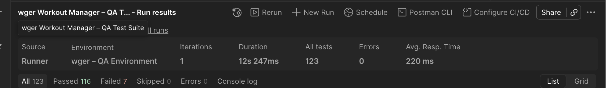

# wger Workout Manager: API Test Suite (Postman)

**Author:** Joanne Trujillo
**Tool:** Postman, with scripted test assertions on every request
**API under test:** [wger Workout Manager](https://wger.de), an open-source fitness REST API
**Coverage:** 51 requests across 8 folders, 123 assertions
**Findings:** 2 confirmed defects, plus documented API behavior changes

---

## Overview

An API test suite for the live wger REST API. It covers authentication, CRUD operations, pagination, input validation, and security checks such as broken object-level authorization, mass assignment, user enumeration, XSS, and oversized payloads.

Every folder includes negative cases. Tests chain together automatically: login saves the access token, and create requests save the new resource's ID for the read, update, and delete tests that follow. A full run needs no manual steps.

Case-by-case documentation lives in [docs/test-cases.md](docs/test-cases.md).

---

## Collection Structure

| Folder | Requests | Coverage |
|--------|----------|----------|
| Authentication | 11 | Login, refresh, verify, invalid credentials, SQL injection, user enumeration, missing and tampered tokens |
| User Profile | 3 | Read profile, partial update, mass-assignment privilege escalation |
| Routines | 9 | Create, read, partial update, delete, delete again, pagination, not found, unauthenticated |
| Exercises (Public) | 7 | List, lookup by ID, not found, filtering, categories, muscles |
| Workout Sessions | 6 | Create, read, invalid date, ordering, delete |
| Weight Log | 4 | Create, list, out-of-range weight, missing date |
| Security Tests | 7 | BOLA on routines and weight entries, expired, missing, and malformed auth, XSS, oversized payload |
| API Health & Structure | 4 | API root, HTTPS, allowed methods, 404 handling |
| **Total** | **51** | **123 assertions** |

---

## Assertion Strategy

Each test asserts what the API **should** do according to REST conventions and wger's own documentation, not whatever it happens to return.

When the API deviates, the test keeps the correct expectation and its name carries a tag such as `[KNOWN: BUG-01]`. Those tests fail on purpose until the defect is fixed. A green result means the API behaves correctly, not that the tests were adjusted to match it.

Known-bug tests also include passing checks that confirm the security outcome. For example, a request that returns the wrong status code is still verified to return no data.

Several tests guard against passing for the wrong reason:
- The invalid refresh token test confirms the token was rejected as invalid, not as a missing field.
- The oversized payload test confirms the rejection was caused by the name length, not by other missing required fields.
- The XSS payload is kept within the 25-character name limit so the length rule doesn't mask the result.

---

## Test Results

**Last full run:** November 11, 2026
**Runner:** Postman Collection Runner, 1 iteration, 500 ms delay

| Metric | Result |
|--------|--------|
| Total assertions | 123 |
| Passed | 116 |
| Failed (known bugs only) | 7 |
| Errors | 0 |
| Avg response time | 220 ms |
| Duration | 12.2 s |



> Response times reflect the public wger.de server and vary with load.

---

## Findings

### Defects

| ID | Tests | Endpoint | Finding |
|----|-------|----------|---------|
| BUG-01 | TC-AUTH-09, TC-AUTH-10, TC-ROUT-07, TC-SEC-03, TC-SEC-04, TC-SEC-05 | Protected endpoints | Requests with a missing, tampered, expired, or malformed token return **403 Forbidden** instead of **401 Unauthorized**. Access is correctly denied and no data is returned, but the status code tells clients the wrong thing: 401 means "authenticate and retry," while 403 means "you are authenticated but not allowed." |
| BUG-02 | TC-AUTH-11 | POST /api/v2/token/refresh | The documented refresh endpoint rejects refresh tokens issued by the current login endpoint with `"Token has no type"`. The sibling `/api/v2/token/verify` endpoint accepts tokens from the same login, so the two documented token endpoints behave inconsistently. Refresh works through `/allauth/app/v1/tokens/refresh`. |

### API behavior observed

These are documented because they affect anyone integrating with the API. None of them is classified as a defect.

- **Login endpoint moved.** `POST /api/v2/token` no longer exists (404). Login is now `POST /allauth/app/v1/auth/login`, with tokens returned under `meta.access_token` and `meta.refresh_token`. The suite was updated to match.
- **Short-lived tokens with rotation.** Access tokens expire after 5 minutes. Each refresh issues a new refresh token and invalidates the old one.
- **Failed logins return 400.** Wrong password, unknown user, empty body, and SQL injection all return 400 with an `errors` list, not 401. Wrong password and unknown user return the same error code, so the API doesn't reveal which usernames exist.
- **Session schema changed.** `workout` is replaced by `routine`, `date`, `time_start`, and `time_end` are replaced by `datetime_start` and `datetime_end`, and session IDs are now UUIDs. Legacy field names are still accepted on create.
- **Weight entry date is optional.** A weight entry without a date is accepted and defaults to the current time.
- **Routine names are limited to 25 characters,** and longer names are rejected with a clear validation error.
- **Body weight must be between 20 and 350 kg.** A negative value is rejected with a message stating the valid range.
- **HTML in text fields is stored as is.** A routine named `<script>alert(1)</script>` is saved unchanged and returned as JSON. That's expected for a JSON API: any client that displays the value is responsible for escaping it.
- **Object-level authorization holds.** Requests for another user's routine or weight entry return 404 with no data, so the API doesn't confirm the resource exists.

### Re-verification notes

The suite was first built in March 2026 and fully re-verified in November 2026 after wger changed its authentication system. Three earlier findings were withdrawn after retesting:

- **Profile updates returning 405** came from a test calling `/userprofile/1/`. The endpoint is `/userprofile/`, and PATCH works there.
- **PATCH requiring all fields** didn't reproduce. A name-only partial update succeeds.
- **The profile returning a single object** instead of a paginated list is by design, since each user has exactly one profile.

---

## Setup

### Prerequisites
- [Postman](https://www.postman.com/downloads/)
- A free [wger account](https://wger.de/en/user/registration) without two-factor login

### Steps

1. Clone the repo:
   ```bash
   git clone https://github.com/jojotrue/wger-qa-test-suite.git
   ```
2. In Postman, click **Import** and select `wger_Workout_Manager_QA_Test_Suite.json`.
3. Create an environment named `wger – QA Environment` with two variables:

   | Variable | Value |
   |----------|-------|
   | `username` | your wger username |
   | `password` | your wger password (set the type to secret) |

   Everything else (`baseUrl`, tokens, and test IDs) lives in the collection and is set automatically during the run.

4. Select the environment, open the collection, click **Run**, set a 500 ms delay, and start the run.

### Running requests one at a time

Access tokens last 5 minutes. If a request unexpectedly returns 401 or 403, send **TC-AUTH-01** again and retry. Requests that use a saved ID need their create request first:

```
TC-AUTH-01   login, saves accessToken and refreshToken
TC-AUTH-02   must run before TC-AUTH-03 (enumeration check)
TC-ROUT-02   creates a routine, saves testRoutineId
TC-SESS-02   creates a session, saves testSessionId
TC-EX-01     saves testExerciseId for TC-EX-02
```

---

## Naming Convention

```
TC-[FOLDER]-[NUMBER] | [METHOD] [Description] – [Scenario] [KNOWN: BUG-XX]
```

Examples:
- `TC-AUTH-01 | POST Login – Valid Credentials`
- `TC-ROUT-06 | GET Routine – Not Found (ID 999999)`
- `TC-AUTH-09 | GET Protected Endpoint – No Token [KNOWN: BUG-01]`

---

## Why wger?

wger is a live, production REST API with token authentication, relational data, and both public and private endpoints. Because it's actively developed, it also changes under you, and this suite has already had to adapt to a full authentication redesign.
